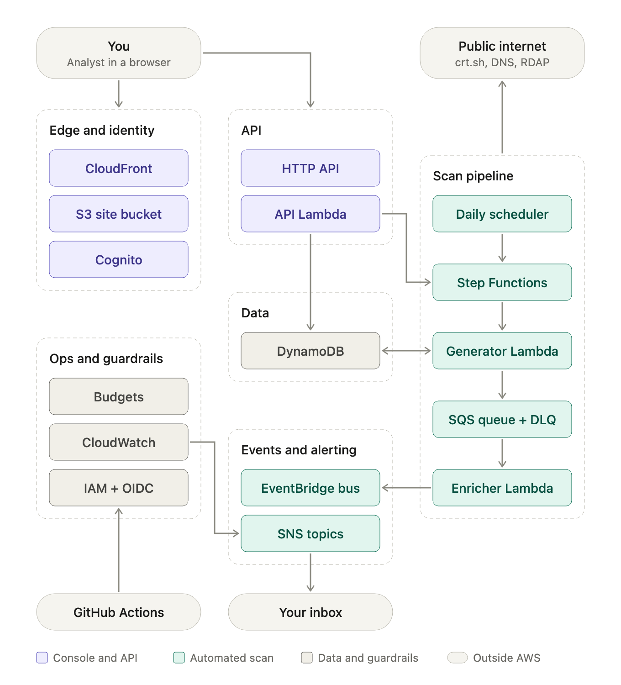
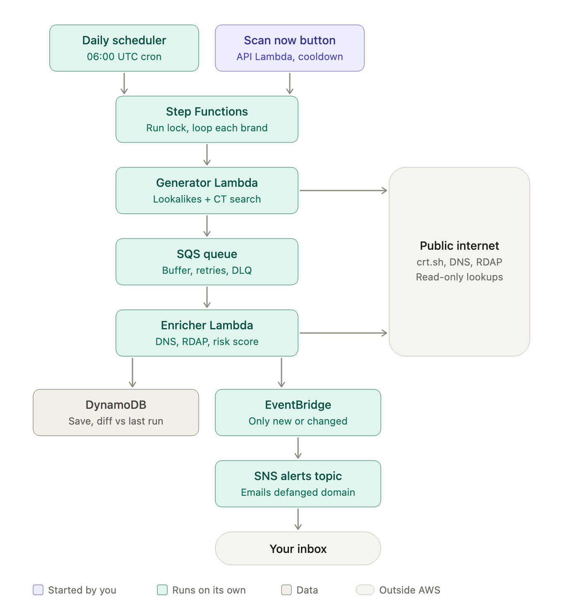
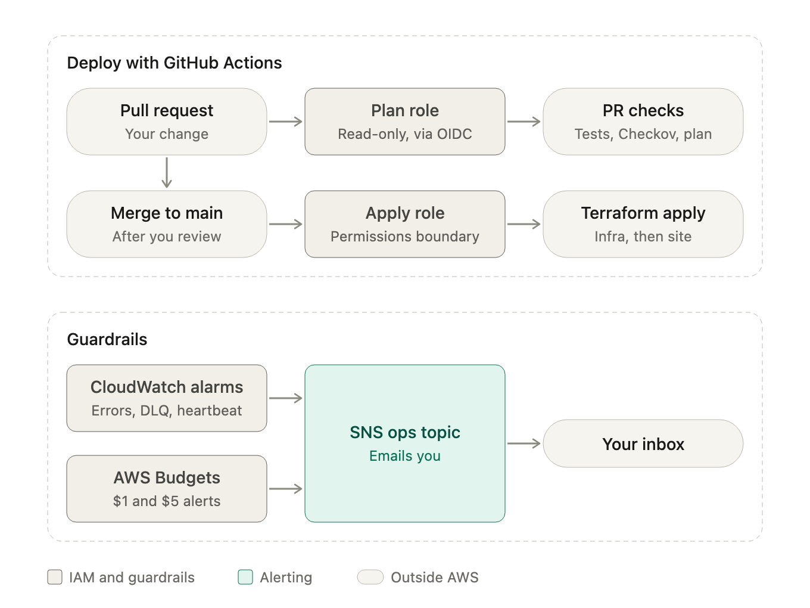

# SquatScope: a beginner-friendly AWS project

> **In one sentence:** SquatScope is like a Google Alert for fake websites. You pick a brand to watch, and every morning it looks for new websites pretending to be that brand and emails you if one looks dangerous.

It's a real, useful security tool, and building it teaches you the AWS services most cloud jobs ask about. It should cost about $1 a month or less to run.

---

## Contents

1. [What the project does](#1-what-the-project-does)
2. [A worked example](#2-a-worked-example)
3. [The three drawings, explained](#3-the-three-drawings-explained)
4. [Which AWS service does which job](#4-which-aws-service-does-which-job)
5. [What it does not do](#5-what-it-does-not-do)
6. [How to build it, in 6 phases](#6-how-to-build-it-in-6-phases)
7. [Cost, and the mistakes that cost money](#7-cost-and-the-mistakes-that-cost-money)
8. [Glossary](#8-glossary)
9. [Why this is a good portfolio project](#9-why-this-is-a-good-portfolio-project)
10. [What was built, and the design choices](#10-what-was-built-and-the-design-choices)

---

## 1. What the project does

### The problem

Scammers register websites that look almost exactly like a real company's, then use them in phishing emails to steal passwords. The earlier someone spots one of these fake domains, the sooner it can be blocked or taken down.

Here are the usual tricks, using a made-up bank called `acmebank.com`:

| Trick | Fake domain | Why it fools people |
|---|---|---|
| Missing letter | `acmebnk.com` | Easy to miss when skimming |
| Swapped letters | `acmbeank.com` | Your brain autocorrects it |
| Lookalike characters | `acrnebank.com` | "rn" looks like "m" |
| Different ending | `acmebank.co` | Looks official |
| Extra words | `acmebank-login.com` | Sounds like a real login page |

### What SquatScope does about it

Every morning, for each brand you watch, SquatScope:

1. **Guesses lookalikes.** It generates hundreds of fake-looking versions of the domain, using the tricks in the table above.
2. **Checks certificate records.** Every HTTPS certificate issued anywhere is logged publicly. Scammers need one to get the padlock icon, so searching those logs finds fakes the guessing step missed.
3. **Looks up each candidate.** It asks public DNS whether the domain exists, whether it points to a server, and whether it has email set up. It asks RDAP (the modern WHOIS) when the domain was registered.
4. **Scores it** from 0 to 100, with reasons you can read.
5. **Compares with yesterday.** Is this domain new, or has it changed?
6. **Emails you** only if it's new and risky, or if it changed in a suspicious way.

You also get a small website where you log in and can:
- see everything it found, riskiest first
- add or remove brands to watch
- paste any domain and get an instant risk score
- click **Scan now** to run a scan straight away

---

## 2. A worked example

Say you watch `acmebank.com`.

**Day 1.** The scan finds `acrnebank.com`. The domain exists but is "parked": nothing is on it and no email is set up. It scores 45 out of 100. SquatScope saves it and keeps checking it every day, but it doesn't email you yet.

**Day 12.** The same domain now has email servers and a fresh HTTPS certificate. That usually means someone is getting ready to send phishing emails. The score jumps to 85, and you get an email like this one (made up for illustration):

```
Subject: [SquatScope] acrnebank[.]com changed (risk 85/100)

Watched brand:  acmebank.com
What changed:   gained mail servers, new HTTPS certificate
Why it's risky:
  - "rn" looks like "m" (1 character away from your brand)
  - registered 14 days ago
  - can now send email
First seen: day 1    Last changed: day 12
```

The domain is written as `acrnebank[.]com` so nobody can click it by accident. This is called defanging.

That change on day 12, from a quiet parked domain to one that's ready for phishing, is exactly what SquatScope is built to catch.

---

## 3. The three drawings, explained

### Drawing 1: the whole system



**How to read it:**

| Color | Meaning |
|---|---|
| Purple | The part you use: the website, the login and the API |
| Teal | The part that runs on its own every day: the scanning and the alerts |
| Gray | Supporting pieces: the database and the safety tools |
| Rounded pill | Things outside AWS: you, GitHub, the public internet, your inbox |

**The six groups:**
- **Edge and identity:** serves the website to your browser (CloudFront + S3) and handles login (Cognito).
- **API:** receives clicks from the website and runs the code behind them (HTTP API + API Lambda).
- **Data:** one database that remembers your brands and everything found (DynamoDB).
- **Scan pipeline:** the daily hunt, from the timer to the final score.
- **Events and alerting:** decides what's worth telling you, then emails you.
- **Ops and guardrails:** permissions, monitoring and budget alerts.

### Drawing 2: what happens during one scan



Read it from top to bottom:

1. **Start.** A timer starts the scan every morning at 06:00 UTC, or you click **Scan now** (which has a cooldown so it can't be spammed).
2. **Step Functions** makes sure only one scan runs at a time, then works through your brands one by one.
3. **Generator Lambda** builds the list of lookalikes for a brand and searches certificate logs. It also re-adds domains it's already tracking so they get checked again.
4. **SQS queue** holds that list, which can be hundreds of domains, so they can be checked in small batches.
5. **Enricher Lambda** checks each domain against DNS and RDAP, scores it, and compares it with yesterday.
6. **Results** go two ways:
   - Every result is saved in **DynamoDB**.
   - New or changed high-risk results go to **EventBridge**, then to **SNS**, then to your inbox.

**Why use a queue instead of checking everything in one go?** If one lookup fails, only that domain is retried, not the whole list. Anything that keeps failing is moved to a dead-letter queue (DLQ) so you can inspect it later instead of losing it.

**Why Step Functions?** It coordinates the steps. It retries when an outside service like crt.sh is having a bad day, stops two scans from overlapping, and shows you a picture of every run so you can see exactly where something went wrong.

### Drawing 3: deploying code and staying safe



**Deploying (top half):**
- **When you open a pull request on GitHub,** it gets read-only access to AWS. It runs your tests and a security scan (Checkov), then posts a preview of what would change (the Terraform plan).
- **When you merge to main,** a second role with more (but still limited) permissions actually applies the changes.
- **No AWS passwords or keys are stored in GitHub.** GitHub proves who it is through OIDC and gets short-lived access each time.

**Guardrails (bottom half):**
- **CloudWatch alarms** email you if something breaks, if failed messages pile up, or if a daily scan didn't run.
- **AWS Budgets** email you if your bill passes $1 and again at $5.

---

## 4. Which AWS service does which job

| Job | AWS service | Why this one |
|---|---|---|
| Serve the website | S3 + CloudFront | Cheap, fast, HTTPS; the files stay private |
| Log you in | Cognito | Managed logins with MFA; free at this size |
| Handle website requests | API Gateway (HTTP API) + Lambda | Code runs only when someone clicks, so it costs almost nothing |
| Store brands and findings | DynamoDB | Pay-per-request database, no server to manage |
| Start the daily scan | EventBridge Scheduler | A cron job without a server |
| Run the scan step by step | Step Functions | Coordinates the steps, retries and shows each run visually |
| Build the list of lookalikes | Generator Lambda | Runs once per brand |
| Hold the list of domains to check | SQS + dead-letter queue | Buffers the work and keeps failures instead of losing them |
| Check and score each domain | Enricher Lambda | Does the lookups, scoring and comparison with yesterday |
| Decide what's worth an alert | EventBridge (event bus + rules) | Lets through only new or changed high-risk findings |
| Send the email | SNS | Simple email delivery |
| Watch for errors | CloudWatch | Logs, metrics and alarms |
| Watch for bills | AWS Budgets | Emails you at $1 and $5 |
| Control who can do what | IAM + GitHub OIDC | Least-privilege permissions, no stored keys |
| Define everything as code | Terraform | Rebuild or delete the whole project with one command |

---

## 5. What it does not do

- **It doesn't visit the suspicious websites.** Every lookup is passive: DNS, registration records and certificate logs. Visiting phishing sites from your own AWS account brings in malware and security risks a learning project doesn't need.
- **It doesn't take sites down or block them.** It finds lookalikes and tells you about them. Takedowns are a possible add-on later.
- **It doesn't use real company or customer data.** Watch your own or made-up brands, never your employer's or its customers', because this runs in a personal AWS account.

---

## 6. How to build it, in 6 phases

Build in order. Each phase ends with something working that you can show someone.

| Phase | What you build | What you learn | What you can demo at the end |
|---|---|---|---|
| **1. Safety first** | Turn on root account MFA, create an IAM user with MFA, set up $1 and $5 budget alerts and an alert email, set up Terraform | IAM basics, how AWS billing works, Terraform state | A test alert lands in your inbox; the budgets show up in the console |
| **2. Website shell + CI/CD** | A private S3 bucket + CloudFront serving a basic web page, deployed by GitHub Actions through OIDC | CDN, private buckets, pipelines without stored keys | The CloudFront URL works but the direct S3 link is blocked; a pull request shows the Terraform plan |
| **3. The API** | HTTP API + Lambda + DynamoDB: add brands, list findings, instant "paste a domain" score | Lambda, API Gateway, DynamoDB design | Paste `paypa1-secure-login.com` and get a high score with reasons |
| **4. The scan worker** | Generator, SQS queue with DLQ, and enricher | Queues, retries, dead-letter queues, handling duplicate messages safely | Run it by hand, watch the queue empty and findings appear; a broken message lands in the DLQ and emails you |
| **5. Automation + alerts** | Step Functions, the daily schedule, EventBridge rules, alert emails | Orchestration, event-driven design, heartbeat alarms | The scan runs on its own; a risky lookalike arrives in your inbox; Step Functions shows each run as a graph |
| **6. Login + polish** | Cognito login with MFA, the full website, a README explaining your design choices | Auth, JWT tokens, security hardening | Log in, see findings, click Scan now; `terraform destroy` then `terraform apply` rebuilds everything |

---

## 7. Cost, and the mistakes that cost money

**Expected cost:** about $0.05 to $0.50 a month, and around $1 in a bad month. Nothing in the design bills by the hour.

> These numbers come from the design review and weren't checked line by line against today's AWS price pages. After your first week, check Cost Explorer yourself.

### Mistakes that cost money

1. **Setting up AWS Organizations or IAM Identity Center on a new account.** This moves the account off the Free plan and the free credits are lost right away. The review checked this against AWS's Free Tier documentation. Use a plain IAM user with MFA instead.
2. **Budget alerts that count free credits.** In Terraform, budgets include credits by default, so they show $0 while your credits drain. Set `include_credit = false`.
3. **Putting the Lambdas in a VPC "for security."** That needs a NAT Gateway, which costs about $33 a month even when nothing is running. This design has no VPC.
4. **Leaving out the cooldown on "Scan now."** A leaked login or a looping script could start thousands of scans and cost roughly $130 to $190 a month in Step Functions charges.
5. **Keeping logs forever.** CloudWatch keeps logs forever unless you set a limit. Set 14 days.
6. **Encrypting the SNS topics with the default AWS key.** This quietly stops Budgets and CloudWatch from sending you alerts. Leave that encryption off; the alerts only contain public domain names.
7. **Turning on extra security services** (GuardDuty, Security Hub, Config, Inspector, Macie). They start billing once their free trials end.

---

## 8. Glossary

| Term | Plain meaning |
|---|---|
| Typosquatting / lookalike domain | Registering a domain that looks like a real brand's, to trick people |
| Phishing | Fake emails or sites that trick people into handing over passwords or money |
| Parked domain | A registered domain with nothing on it yet |
| DNS | The internet's phone book: turns a name like `acmebank.com` into a server address |
| MX record | The DNS entry that says where a domain's email goes. If a lookalike gains one, it can send email |
| RDAP | The modern WHOIS: tells you when a domain was registered and by which registrar |
| Certificate Transparency (CT) | Public logs of every HTTPS certificate issued. crt.sh is a free site for searching them |
| Defanged | Writing a domain as `evil[.]com` so it can't be clicked by accident |
| Serverless | You write the code and AWS runs it on demand; there are no servers for you to manage |
| Lambda | AWS's serverless functions: code that runs when something triggers it |
| Queue (SQS) | A waiting line of work items that workers pick up and process |
| Dead-letter queue (DLQ) | Where items that keep failing get parked so you can inspect them |
| Idempotent | Doing the same thing twice has the same effect as doing it once, so duplicate messages don't create duplicate findings |
| Step Functions | A visual workflow that runs steps in order, with retries and error handling |
| Event bus (EventBridge) | A message router: things publish events, and rules decide where each event goes |
| IAM role | A set of permissions that a service or person can take on temporarily |
| Least privilege | Giving each piece only the exact permissions it needs |
| Permissions boundary | A hard ceiling on what a role can ever be allowed to do |
| OIDC | A way for GitHub to prove its identity to AWS without stored passwords |
| Terraform | Infrastructure as code: you describe your AWS setup in files, and Terraform builds it |
| CDN (CloudFront) | A network of servers around the world that deliver your website quickly |
| MFA / TOTP | Two-step login using a 6-digit code from an authenticator app |
| JWT | A signed token your browser sends with each request to prove you're logged in |

---

## 9. Why this is a good portfolio project

- **It's a real tool, not a tutorial copy.** Brand-protection and security teams use tools like this, so you can demo it: "here's a lookalike it caught, and here's the alert it sent."
- **It covers what interviewers ask about:** serverless, queues, events, IAM, infrastructure as code and CI/CD.
- **It shows good judgment:** it's cheap, secure by default, and your README can explain why each piece was chosen.
- **It's close to cybersecurity work,** so it fits naturally if you're in or moving toward that field.

---

## 10. What was built, and the design choices

Everything below is defined in Terraform in this repo and deployed by GitHub Actions.

### Repo layout

| Folder | What's in it |
|---|---|
| `bootstrap/` | The S3 bucket that holds Terraform's state. Applied once, by hand |
| `global/` | GitHub OIDC trust, the plan and deploy roles, the ECR repository |
| `modules/website` | Private S3 bucket + CloudFront, with AWS's managed security headers |
| `modules/auth` | Cognito user pool (MFA required, no self sign-up) and the website's app client |
| `modules/api` | HTTP API with a Cognito JWT authorizer, the API Lambda, the DynamoDB tables |
| `modules/scan` | SQS queue + DLQ, generator and enricher Lambdas, the findings event bus, alert emails |
| `modules/automation` | Step Functions workflow, daily schedule, "scan didn't run" alarm |
| `envs/dev` | Wires the modules together for the dev environment |
| `app/scorer` | Python code for all three Lambdas (one container image) |
| `site/` | The single-page website |

### Choices worth explaining

- **One container image, three Lambdas.** The API, generator and enricher share the scoring code, so they ship as one image and each one just runs a different handler. The image tag is the git hash of `app/scorer`, so unchanged code is never rebuilt.
- **No stored AWS keys.** GitHub proves who it is with OIDC. Pull requests get a read-only role (plan only); only `main` gets the deploy role.
- **The queue is sized to the code.** The visibility timeout (6 min) is longer than the enricher's timeout, so a message never reappears while it's still being worked on. After 3 failures a message moves to the DLQ, and an alarm emails you.
- **Failures are retried one domain at a time.** The enricher reports exactly which messages in a batch failed, so SQS retries only those.
- **Duplicate messages are harmless.** Checking the same domain twice gives "unchanged" the second time, so it never triggers a second alert.
- **Publish, then save.** The enricher sends the "new or changed" event before saving the finding. If saving fails, the retry sends a duplicate alert. Saving first would be worse: the retry would see "unchanged" and the alert would be lost.
- **Events decide who gets told.** The enricher just announces findings. An EventBridge rule picks the high-risk new or changed ones and formats the email, so alert rules can change without touching code.
- **Scans can't overlap.** Each run first checks whether another run is in progress and stops if one is.
- **"Scan now" has a cooldown with no extra database.** Each manual run is named after the current 15-minute window, and Step Functions refuses a second run with the same name.
- **A heartbeat, not just error alarms.** If no scan succeeds in 24 hours you get an email, which catches a schedule that silently stopped.
- **Login is handled by Cognito.** The site uses Cognito's hosted login page with the authorization code flow + PKCE (a browser can't keep a client secret). Every API route checks the token, and CORS only allows the SquatScope website.
- **Passive lookups only.** DNS over HTTPS, RDAP and certificate logs. Suspicious sites are never visited, and domains are shown defanged (`evil[.]com`).
- **Cheap by design.** No VPC or NAT Gateway, pay-per-request DynamoDB, logs kept for 14 days, a rate-limited API, at most 2 enrichers running at a time.
- **Secrets stay out of the public repo.** The alert email is a GitHub secret; the site's settings (API URL, login domain) are written by CI from Terraform outputs.

### Not built (on purpose)

Checkov in CI, a prod environment, and taking sites down. They're reasonable next steps, but they were left out to keep the project focused.

